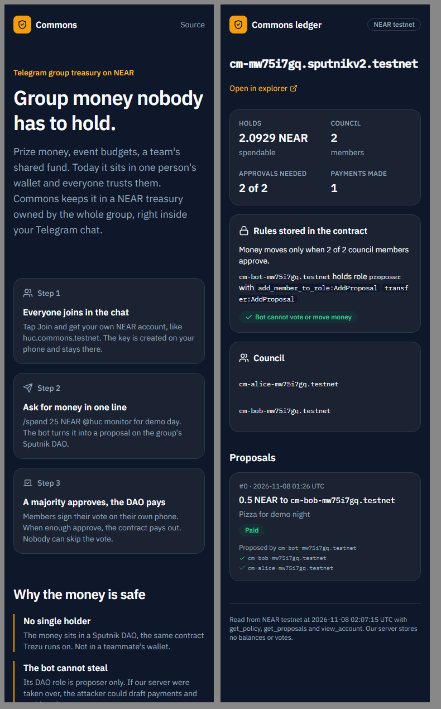
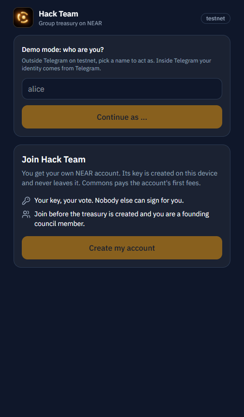
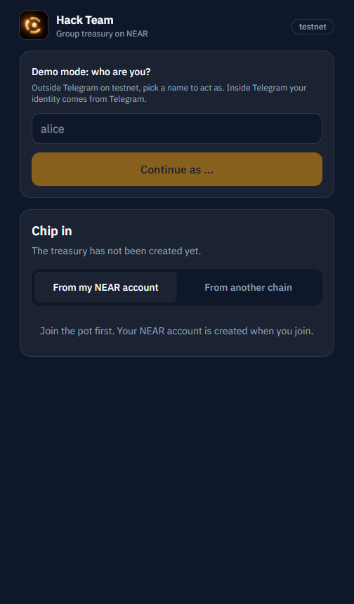

# Commons

**Group money nobody has to hold.** A Telegram group treasury on NEAR. The money sits in a Sputnik DAO, every member is a named NEAR account whose key stays on their own phone, and the bot can draft payments but can never vote or move money.

Built for NEAR Hackathon 2026. Tracks: **Social Money**, **Real-World Money**. Runs on NEAR testnet.

**Live:** https://commons-near.vercel.app · **Telegram bot:** [@commons_near_bot](https://t.me/commons_near_bot) · **Public ledger of the demo DAO:** https://commons-near.vercel.app/c/testnet-demo-vp4rgk.sputnikv2.testnet



## The problem

A team's shared money (prize money, an event budget, a project fund) almost always lands in one person's wallet. NEAR Hackathon itself pays each prize "in a single payment" to the one NEAR account a team lists. Everyone else trusts that person to pay them back.

Commons keeps that money in a NEAR treasury the whole group owns, run from the chat the group already lives in:

1. Someone sends `/commons` in the group. Each member taps **Join** and gets a NEAR account like `huc.commons.testnet`. The key is generated on their phone and never leaves it.
2. A founder taps **Create treasury**. Commons deploys a Sputnik DAO with the founders as council and the bot as `proposer` only.
3. Anyone on the council asks for money in one line: `/spend 25 NEAR @huc monitor for demo day`. The bot files a Transfer proposal and posts a vote card.
4. Members approve on their own phones (Telegram Mini App). When a majority approves, the contract pays out and the bot posts the result.

## Judges: start here

Needs Node 22.6 or newer and npm. Nothing below needs a key, a wallet or a Telegram account.

1. Install:
   ```
   npm ci
   ```
2. Run the tests. Expect `Tests  145 passed (145)`:
   ```
   npm test
   ```
3. Run the whole story offline (real bot logic, simulated Sputnik rules). Expect 12 steps, each `PASS`, ending with `All steps passed.`:
   ```
   npm run demo
   ```
   Steps 8 to 11 are the attack: someone holding the bot's key drafts a payment to itself, tries to approve it, and tries to rewrite the DAO policy. The contract refuses with `ERR_PERMISSION_DENIED` and the pot keeps its money.
4. Check the live testnet DAO from our last run straight from the chain. Expect `All checks passed.`:
   ```
   npm run verify
   ```
   It reads `testnet-demo-vp4rgk.sputnikv2.testnet` (named in [`docs/demo-run.log`](docs/demo-run.log)) and checks that the bot can only propose, that no role is open to everyone, that the bot never voted and that every payment carries council approvals. Pass any DAO id to check another one: `npm run verify -- <dao>.sputnikv2.testnet`.
5. Optional, needs network: the same story on NEAR testnet with brand-new accounts. Writes `docs/demo-run.log`:
   ```
   npm run demo:testnet
   ```
   It makes one call to the public testnet faucet. The faucet allows only a few accounts per IP per day; if it answers 429, set `SPONSOR_ACCOUNT_ID` and `SPONSOR_PRIVATE_KEY` to any testnet account holding about 9 NEAR.
6. Optional: one dry-run NEAR Intents quote for a cross-chain chip-in:
   ```
   npm run quote -- arb-usdc 10
   ```
   On 2026-11-08 the unauthenticated 1Click endpoint answered every quote with HTTP 500 after 25 seconds (see Honest limits). The command then prints `No quote: ...` and exits 1; that is the 1Click service, not this repo.
7. Optional: check the live deployment from the outside (no secrets). Expect 11 `PASS` lines and `All checks passed.`:
   ```
   npm run smoke
   ```
   It loads the landing page, the Mini App and the public ledger (which must show "Bot cannot vote or move money" read from the chain), and checks that the webhook and the Mini App endpoints refuse requests without Telegram's secret or signature.
8. Optional: the web app locally. `npm run build && npm start`, then open `http://localhost:3000/c/testnet-demo-vp4rgk.sputnikv2.testnet` for the public ledger.

## How NEAR is used

| NEAR piece | What it does in Commons | Code |
|---|---|---|
| Sputnik DAO v2 (`sputnikv2.testnet` factory, the contract Trezu builds on) | Holds the money, stores the rules, counts votes, pays out | [`lib/near/rpcChain.ts`](lib/near/rpcChain.ts), [`lib/pot.ts`](lib/pot.ts) `createTreasury` |
| DAO policy roles | Founders form the `council`. The bot's role `proposer` holds exactly `transfer:AddProposal` and `add_member_to_role:AddProposal` | [`lib/near/policy.ts`](lib/near/policy.ts) `buildPolicy`, `botIsProposerOnly` |
| Named sub-accounts | Every member is `<name>.<sponsor>`, so every vote and payment traces to a person | [`lib/near/names.ts`](lib/near/names.ts), [`lib/pot.ts`](lib/pot.ts) `joinPot` |
| Full-access keys created on the device | The Mini App generates the key; the server only ever sees the public key | [`app/app/MiniApp.tsx`](app/app/MiniApp.tsx) `Join`, [`lib/client/keys.ts`](lib/client/keys.ts) |
| `act_proposal` signed in the browser | Votes go from the member's phone straight to NEAR | [`app/app/MiniApp.tsx`](app/app/MiniApp.tsx) `Vote` |
| NEAR Intents (1Click API) | Live dry-run quotes for chipping in USDC or USDT from Base, Arbitrum, Solana, Ethereum or Tron | [`lib/intents.ts`](lib/intents.ts), [`app/api/quote/route.ts`](app/api/quote/route.ts) |
| RPC views (`get_policy`, `get_proposals`, `view_account`) | The public ledger and `npm run verify` read everything from the chain, never from our database | [`app/c/[dao]/page.tsx`](app/c/[dao]/page.tsx), [`scripts/verify.ts`](scripts/verify.ts) |

## What is real

| Claim | Code | Test or proof |
|---|---|---|
| The bot cannot vote | `PROPOSER_PERMISSIONS` in [`lib/near/policy.ts`](lib/near/policy.ts) | `tests/policy.test.ts`, `npm run demo` step 9; on testnet the bot's `act_proposal` failed with `ERR_PERMISSION_DENIED` ([tx 768dnS…](https://testnet.nearblocks.io/txns/768dnSErMV4LzugH8s6fgghxVerHi5m55CgmptSv7SM8), [tx 6LrRnX…](https://testnet.nearblocks.io/txns/6LrRnXMJdzNz6t4bjGqPVCMX7KkqJtMwt363w3jsQ8AS)); `npm run verify` confirms the bot never voted on `testnet-demo-vp4rgk` |
| The bot cannot change the rules | same | `npm run demo` step 10; on testnet the bot's `ChangePolicy` proposals failed with `ERR_PERMISSION_DENIED` ([tx G3Y4cx…](https://testnet.nearblocks.io/txns/G3Y4cxLAHg5MZjQKKirUbmVPbNBTQswrdrY9dqyfXUUK), [tx EB2k3S…](https://testnet.nearblocks.io/txns/EB2k3Snhmq8tEWsNw16xNvJc1Mi24p9tPRjDNL2GS2Eu)) |
| The verifier cannot be fooled by open roles | `botIsProposerOnly` flags `Everyone` and token-weighted `Member` roles | `tests/policy.test.ts` "botIsProposerOnly fails when a Member role can approve" |
| Voters see what the contract will do, not the proposer's text | `viewKind` in [`lib/proposalView.ts`](lib/proposalView.ts); the Mini App offers a vote only on kinds Commons files and shows anything else as raw JSON with a warning | `tests/proposalView.test.ts` |
| Only people in the Telegram group can join | `getChatMember` check in `joinPot` | `tests/e2e-bot.test.ts` "only members of the Telegram group can join" |
| A join cannot be doubled or lose its key | the database claims the seat before the account exists; the Mini App reuses an unfinished join's key and checks on chain (`view_access_key`) that the new account holds it | `tests/e2e-bot.test.ts` "concurrent joins by the same person create one account and agree on it", `tests/client.test.ts` |
| Money moves only with a council majority | `votesNeeded` in [`lib/near/policy.ts`](lib/near/policy.ts), Sputnik's own threshold | `tests/fakeChain.test.ts`; testnet payment #0 of `testnet-demo-vp4rgk` approved by alice_cm-7001 and bob_cm-7002, checked by `npm run verify` |
| Member keys never reach the server | `/api/join` takes `publicKey` only | [`app/api/join/route.ts`](app/api/join/route.ts); the server code has no field for a private key |
| New members are voted in, nobody is left out | `ensureVotedIn` in [`lib/pot.ts`](lib/pot.ts) files exactly one `AddMemberToRole` for anyone not on the council, including someone who joined while the treasury was being created or whose proposal failed; `/commons` repairs stale roles from the chain | `tests/e2e-bot.test.ts` "a late joiner is pending until the council votes them in", "someone who joins while the treasury is being created is not left out", "a late joiner whose council proposal failed gets one filed on retry"; testnet run step 7 |
| Mini App requests are authenticated | `verifyInitData` (Telegram's HMAC scheme) | `tests/tgauth.test.ts` "rejects forged and stale initData" |
| Results posted in the group come from the chain | `refreshProposal`, `waitForVote` in [`lib/pot.ts`](lib/pot.ts) | `tests/e2e-bot.test.ts` "vote notify trusts the chain only" |
| The webhook only accepts Telegram | secret token check in [`app/api/telegram/route.ts`](app/api/telegram/route.ts) | manual: a POST without the header returns 403 |

The full transcript of the testnet run, with explorer links for every account, vote and payment, is in [`docs/demo-run.log`](docs/demo-run.log). Security reasoning is in [`THREAT_MODEL.md`](THREAT_MODEL.md).

## Screens

| Join (Mini App) | Chip in (Mini App) |
|---|---|
|  |  |

Outside Telegram the Mini App shows a demo identity picker (only with `DEMO_MODE=1` on testnet). Inside Telegram the identity comes from Telegram and the colors follow the user's Telegram theme.

## How it fits together

```
Telegram group ──/commons, /spend──> webhook (app/api/telegram) ──> lib/bot/handlers.ts ──> lib/pot.ts
      │                                                                                       │
      │ taps a t.me/<bot>/app link                                     bot key: add_proposal only
      v                                                                                       v
Mini App (app/app) ── public key ──> /api/join ── sponsor creates <name>.<sponsor> ──> NEAR testnet
      │                                                                                 Sputnik DAO
      └── act_proposal / transfer, signed with the key on the phone ─────────────────────────┘
Ledger (app/c/[dao]) and npm run verify <── get_policy, get_proposals, view_account ── NEAR RPC
```

Postgres (Neon in production, PGlite locally) only maps Telegram chats and users to NEAR accounts and remembers which message shows which proposal.

## Run your own bot

1. Create a bot with [@BotFather](https://t.me/BotFather) (`/newbot`), then register a Mini App for it with `/newapp` and short name `app`, pointing at `https://<your-app>/app`.
2. `npm run setup:testnet` creates a sponsor account (from the faucet, or reuses `SPONSOR_ACCOUNT_ID`/`SPONSOR_PRIVATE_KEY`) and a bot sub-account, and prints the env lines once. Each new group costs the sponsor 6 NEAR for the DAO plus 0.5 NEAR per member, so at least 7 NEAR.
3. Create a Neon Postgres database. Put everything from [`.env.example`](.env.example) into the Vercel project (or `.env.local`), with `APP_URL` set to your deployment.
4. Deploy (`vercel deploy`), then `npm run set-webhook`.
5. Add the bot to a group and send `/commons`.

## Honest limits

- **Testnet.** Everything runs on NEAR testnet. Testnet pots hold NEAR only; USDC spending is wired for mainnet but has not been run there.
- **NEAR Intents quotes.** On 2026-11-08 the unauthenticated 1Click quote endpoint timed out on every attempt (HTTP 500, "Failed to receive response within timeout of 25000ms"). The client reports that instead of crashing. A partner JWT from partners.near-intents.org goes into `ONECLICK_JWT`. Intents have no testnet, so a testnet pot never hands out a deposit address; live deposits need mainnet and `INTENTS_LIVE=1`.
- **Cost per group.** A Sputnik DAO locks about 5.5 NEAR of storage, paid by the sponsor. A Telegram user can join many groups, and each join costs the sponsor 0.5 NEAR; there is no rate limit beyond one account per user per group yet.
- **Lost phone.** The key lives on the phone (Telegram SecureStorage on mobile clients with Bot API 9.0+, otherwise the browser's localStorage). The Mini App can show the key for backup. If it is lost, the council can remove the member with a `RemoveMemberFromRole` proposal in any Sputnik UI; the bot does not offer that yet.
- **The demo log.** [`docs/demo-run.log`](docs/demo-run.log) is the 2026-11-10 testnet run, 12 of 12 steps passing. An earlier run (2026-11-08, DAO `testnet-demo-74ohgb`) failed step 9 because the script read a proposal one block too early; that led to `waitForVote`.
- **Trusting the web app.** The bot key alone cannot move money. But the same server also serves the Mini App's code, so someone who took over the whole deployment could ship code that reads keys from the phone the next time a member opens it. The Mini App does check on chain that each new account holds the key the phone created, which stops a server from slipping in its own key at join time. Signing with an existing wallet (see Not implemented) would remove this trust.
- **Double taps.** Joins are locked by the database (one seat per person per group). Treasury creation is locked per server process, and the DAO name is fixed per group, so a second create from another process fails on chain instead of making a second DAO.

## Not implemented

- Removing members or changing the threshold from Telegram (possible in any Sputnik UI).
- Storage registration for USDC on mainnet DAOs before the first cross-chain chip-in.
- Signing in with an existing NEAR wallet (NEAR Connect) instead of a key created in the Mini App.
- Gasless votes through meta-transactions; members get 0.5 NEAR for gas instead.
- Reminders for members who have not voted yet, and a CSV export of the ledger.
- Rate limits on joins across many groups.
- An AI assistant. Commons has no LLM anywhere in the money path.

## Disclosure

- Written during the hackathon window. The repository was started on 2026-11-08, after the 2026-10-19 announcement; there is no earlier code.
- Most of the code was written with Claude Code (Anthropic) from a written plan ([`docs/superpowers/plans/2026-11-08-commons.md`](docs/superpowers/plans/2026-11-08-commons.md)) and reviewed by the author.
- Patterns (a fetch-based Telegram client, a Neon/PGlite SQL adapter, a fake-Telegram test harness) follow the author's earlier project Pocket Pundit; no code was copied.
- Libraries: next, react, near-api-js, @neondatabase/serverless, @electric-sql/pglite, tailwindcss, vitest. Fonts: IBM Plex via next/font.
- Uses NEAR's public testnet faucet helper, FastNEAR RPC, nearblocks.io links and the NEAR Intents 1Click API.

## License

MIT, see [`LICENSE`](LICENSE).
