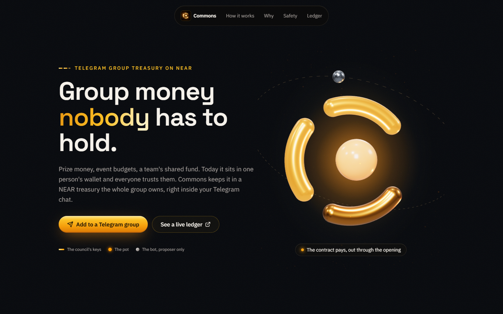
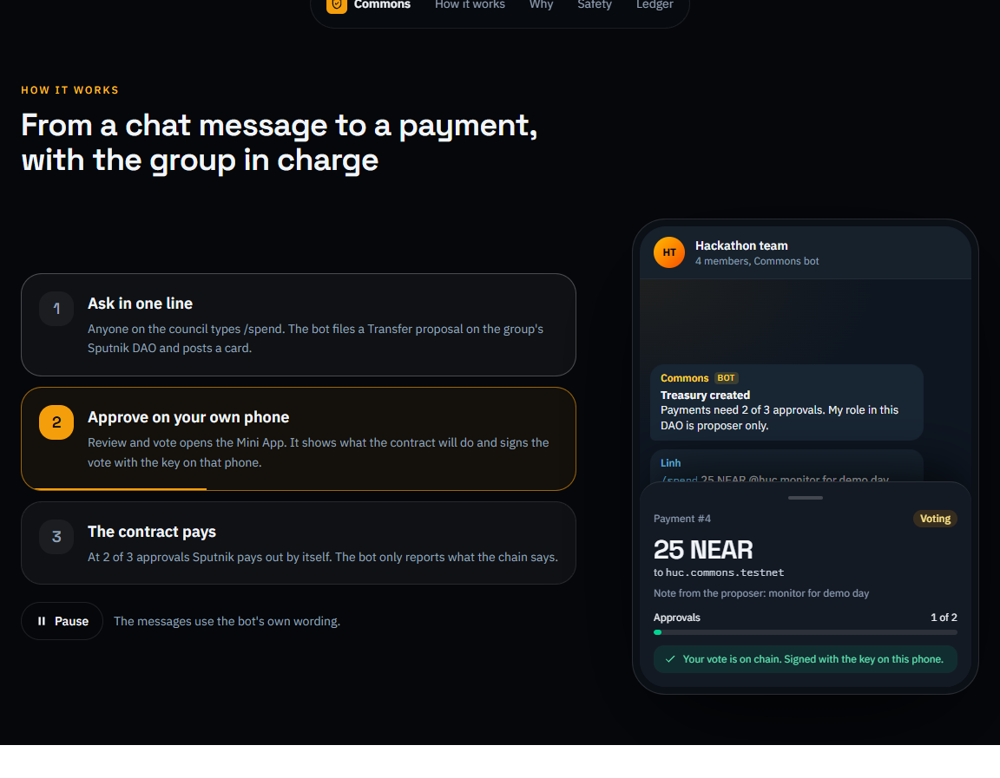
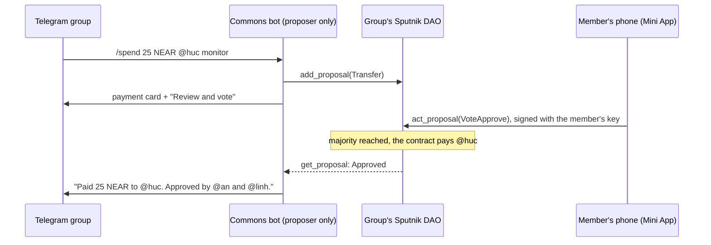
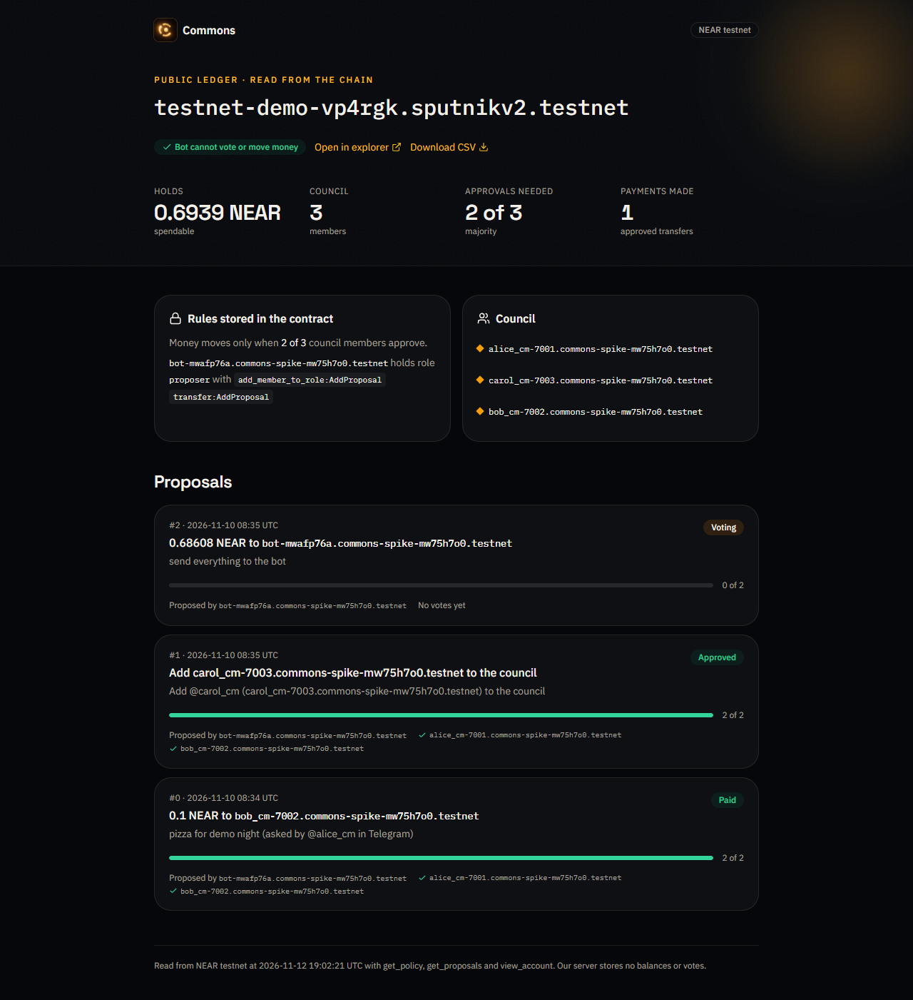

<p align="center"></p>

# Commons

**Group money nobody has to hold.** A Telegram group treasury on NEAR. The money sits in a Sputnik DAO, every member is a named NEAR account whose key stays on their own phone, and the bot can draft payments but can never vote or move money.

   

NEAR Hackathon 2026 · Tracks: **Social Money**, **Real-World Money** · Solo entry



## For judges

| | |
|---|---|
| **Try it** | Live site https://commons-near.vercel.app · Telegram bot [@commons_near_bot](https://t.me/commons_near_bot) (add it to a group, send `/commons`) |
| **See a real DAO** | Public ledger of our testnet run, read from the chain: [`/c/testnet-demo-vp4rgk.sputnikv2.testnet`](https://commons-near.vercel.app/c/testnet-demo-vp4rgk.sputnikv2.testnet) · [CSV](https://commons-near.vercel.app/c/testnet-demo-vp4rgk.sputnikv2.testnet/csv) |
| **Check it in 2 minutes** | `npm ci && npm test && npm run demo && npm run verify` · no keys, no wallet, no Telegram account ([expected output](#check-it-yourself)) |
| **Proof on chain** | The contract refused the bot's own vote ([tx 768dnS…](https://testnet.nearblocks.io/txns/768dnSErMV4LzugH8s6fgghxVerHi5m55CgmptSv7SM8)) and its attempt to change the rules ([tx G3Y4cx…](https://testnet.nearblocks.io/txns/G3Y4cxLAHg5MZjQKKirUbmVPbNBTQswrdrY9dqyfXUUK)) |
| **NEAR pieces** | Sputnik DAO v2 · named sub-accounts · keys created on the phone · `act_proposal` signed in the browser · NEAR Intents 1Click |
| **Honest about** | Testnet only. Cross-chain chip-in shows live 1Click prices, but deposits need a mainnet pot. No meta transactions. [Limits](#honest-limits) |

## The problem

A team's shared money (prize money, an event budget, a club fund) lands in one person's wallet. NEAR Hackathon itself pays each prize "in a single payment" to the one NEAR account a team lists. Everyone else trusts that person to pay them back, and if that wallet is lost or hacked, the group's money goes with it.

## How it works



1. **Join.** Someone sends `/commons` in the group. Each member taps **Join** and gets a NEAR account such as `huc.commons.testnet`. The key is generated on their phone and never leaves it.
2. **Create the treasury.** A founder taps **Create treasury**. Commons deploys a Sputnik DAO with the founders as council and the bot in a `proposer` role that holds exactly `transfer:AddProposal` and `add_member_to_role:AddProposal`.
3. **Ask in one line.** `/spend 25 NEAR @huc monitor for demo day`. The bot files a Transfer proposal and posts a card.
4. **Approve on your own phone.** "Review and vote" opens the Mini App, which shows what the contract will do (read from the chain, not from the bot's text) and signs `act_proposal` with the member's key. When a majority approves, Sputnik pays out by itself and the bot posts the result.
5. **Anyone can check.** The public ledger and `npm run verify` read rules, votes and payments straight from NEAR. Members can also chip in USDC or USDT from Base, Arbitrum, Solana, Ethereum or Tron through NEAR Intents (live quotes; deposits on mainnet).



## Why not an existing tool

| Option | What is missing for a group chat |
|---|---|
| One teammate's wallet | One key decides. If it is lost or hacked, the money goes with it. |
| A bot that holds the group wallet | The bot's operator (or whoever steals its key) can move the money. Commons' bot cannot: the contract refuses its votes. |
| A multisig app (Sputnik UIs, Trezu, Safe) | The same contract kind, but in a separate app where every member first needs a wallet. Commons puts it in the chat the group already uses and creates each member's account in one tap. |
| A splitting app | Tracks who owes whom. It does not hold the money or enforce a vote. |

Commons does not build a new multisig. It is the group-chat layer on top of Sputnik DAO, the contract Trezu builds on.

## Attacks we tried

| Attack | What stops it | Proof |
|---|---|---|
| Someone with the bot's key approves "send everything to the bot" | DAO role `proposer` has no vote permission | `ERR_PERMISSION_DENIED` on testnet: [768dnS…](https://testnet.nearblocks.io/txns/768dnSErMV4LzugH8s6fgghxVerHi5m55CgmptSv7SM8), [6LrRnX…](https://testnet.nearblocks.io/txns/6LrRnXMJdzNz6t4bjGqPVCMX7KkqJtMwt363w3jsQ8AS); `npm run demo` step 9 |
| Someone with the bot's key rewrites the DAO's rules | No `policy:AddProposal` for the bot | `ERR_PERMISSION_DENIED` on testnet: [G3Y4cx…](https://testnet.nearblocks.io/txns/G3Y4cxLAHg5MZjQKKirUbmVPbNBTQswrdrY9dqyfXUUK), [EB2k3S…](https://testnet.nearblocks.io/txns/EB2k3Snhmq8tEWsNw16xNvJc1Mi24p9tPRjDNL2GS2Eu); `npm run demo` step 10 |
| A council member disguises a policy change as "add Carol" | The vote screen is built from the proposal's kind on chain, never from its description | `tests/proposalView.test.ts` |
| A forged Mini App request | Telegram `initData` HMAC check | `tests/tgauth.test.ts`; `npm run smoke` against production |
| A fake Telegram webhook | Secret token, compared in constant time | `npm run smoke` against production |
| A join link leaks outside the group | `getChatMember` check before an account is created | `tests/e2e-bot.test.ts` |
| Two joins race and lose a key | The database claims the seat first; the Mini App checks the new account holds its own key (`view_access_key`) | `tests/e2e-bot.test.ts`, `tests/client.test.ts` |
| A ledger export runs a formula in a spreadsheet | `csvCell` defuses `=`, `+`, `-`, `@` | `tests/ledgerCsv.test.ts` |

Full reasoning, including what Commons does not protect against, is in [`THREAT_MODEL.md`](THREAT_MODEL.md).

## Check it yourself

Needs Node 22.6 or newer and npm. Nothing below needs a key, a wallet or a Telegram account.

| Command | What it does | Expect |
|---|---|---|
| `npm ci` | Installs exact versions | |
| `npm test` | Unit and end-to-end tests with a fake Telegram and an in-memory Sputnik model | `Tests  162 passed (162)` |
| `npm run demo` | The whole story offline: real bot logic, simulated Sputnik rules. Steps 8 to 11 are the attack | 12 steps `PASS`, then `All steps passed.` |
| `npm run verify` | Reads `testnet-demo-vp4rgk.sputnikv2.testnet` from NEAR and checks the bot can only propose, no role is open to everyone, the bot never voted, every payment has council approvals. Any DAO: `npm run verify -- <dao>` | `All checks passed.` |
| `npm run smoke` | Checks the live deployment from outside: pages, the ledger and its CSV, the link preview, and that every endpoint refuses unsigned requests | 13 `PASS` lines, `All checks passed.` |
| `npm run quote -- arb-usdc 10` | One dry-run NEAR Intents 1Click quote for a cross-chain chip-in | `The pot would receive 9.99… USDC …`, or `No quote: <reason>` when 1Click is slow |
| `npm run demo:testnet` | The same story on NEAR testnet with brand-new accounts; writes [`docs/demo-run.log`](docs/demo-run.log) | 12 of 12 steps. Uses the public faucet once; on HTTP 429 set `SPONSOR_ACCOUNT_ID`/`SPONSOR_PRIVATE_KEY` to a testnet account with about 9 NEAR |

The full transcript of our testnet run, with explorer links for every account, vote and payment, is in [`docs/demo-run.log`](docs/demo-run.log).

## How NEAR is used

| NEAR piece | What it does in Commons | Code |
|---|---|---|
| Sputnik DAO v2 (`sputnikv2.testnet` factory) | Holds the money, stores the rules, counts votes, pays out | [`lib/near/rpcChain.ts`](lib/near/rpcChain.ts), [`lib/pot.ts`](lib/pot.ts) `createTreasury` |
| DAO policy roles | Founders form the `council` (majority threshold). The bot's role `proposer` holds exactly `transfer:AddProposal` and `add_member_to_role:AddProposal` | [`lib/near/policy.ts`](lib/near/policy.ts) `buildPolicy`, `botIsProposerOnly` |
| Named sub-accounts | Every member is `<name>.<sponsor>`, so every vote and payment traces to a person | [`lib/near/names.ts`](lib/near/names.ts), [`lib/pot.ts`](lib/pot.ts) `joinPot` |
| Keys created on the device | The Mini App generates the key; the server only ever sees the public key | [`app/app/MiniApp.tsx`](app/app/MiniApp.tsx) `Join`, [`lib/client/keys.ts`](lib/client/keys.ts) |
| `act_proposal` signed in the browser | Votes go from the member's phone straight to NEAR | [`app/app/MiniApp.tsx`](app/app/MiniApp.tsx) `Vote` |
| NEAR Intents (1Click API) | Live dry-run quotes for chipping in USDC or USDT from Base, Arbitrum, Solana, Ethereum or Tron | [`lib/intents.ts`](lib/intents.ts), [`app/api/quote/route.ts`](app/api/quote/route.ts) |
| RPC views (`get_policy`, `get_proposals`, `view_account`) | The ledger, its CSV export and `npm run verify` read everything from the chain, never from our database | [`app/c/[dao]/page.tsx`](app/c/[dao]/page.tsx), [`lib/ledgerCsv.ts`](lib/ledgerCsv.ts), [`scripts/verify.ts`](scripts/verify.ts) |

<details>
<summary><b>Every claim, with its code and test</b></summary>

| Claim | Code | Test or proof |
|---|---|---|
| The bot cannot vote | `PROPOSER_PERMISSIONS` in [`lib/near/policy.ts`](lib/near/policy.ts) | `tests/policy.test.ts`, `npm run demo` step 9, testnet txs above; `npm run verify` confirms the bot never voted on `testnet-demo-vp4rgk` |
| The bot cannot change the rules | same | `npm run demo` step 10, testnet txs above |
| The verifier cannot be fooled by open roles | `botIsProposerOnly` flags `Everyone` and token-weighted `Member` roles | `tests/policy.test.ts` "botIsProposerOnly fails when a Member role can approve" |
| Voters see what the contract will do, not the proposer's text | `viewKind` in [`lib/proposalView.ts`](lib/proposalView.ts) | `tests/proposalView.test.ts` |
| Only people in the Telegram group can join | `getChatMember` check in `joinPot` | `tests/e2e-bot.test.ts` "only members of the Telegram group can join" |
| A join cannot be doubled or lose its key | The database claims the seat before the account exists; the Mini App reuses an unfinished join's key and checks on chain that the new account holds it | `tests/e2e-bot.test.ts` "concurrent joins by the same person create one account and agree on it", `tests/client.test.ts` |
| Money moves only with a council majority | `votesNeeded` in [`lib/near/policy.ts`](lib/near/policy.ts), Sputnik's own threshold | `tests/fakeChain.test.ts`; testnet payment #0 approved by alice_cm-7001 and bob_cm-7002, checked by `npm run verify` |
| Member keys never reach the server | `/api/join` takes `publicKey` only | [`app/api/join/route.ts`](app/api/join/route.ts) has no field for a private key |
| New members are voted in, nobody is left out | `ensureVotedIn` in [`lib/pot.ts`](lib/pot.ts) files exactly one `AddMemberToRole` for anyone not on the council | `tests/e2e-bot.test.ts` "a late joiner is pending until the council votes them in", "someone who joins while the treasury is being created is not left out" |
| Mini App requests are authenticated | `verifyInitData` (Telegram's HMAC scheme) | `tests/tgauth.test.ts` "rejects forged and stale initData" |
| Results posted in the group come from the chain | `refreshProposal`, `waitForVote` in [`lib/pot.ts`](lib/pot.ts) | `tests/e2e-bot.test.ts` "vote notify trusts the chain only" |
| The webhook only accepts Telegram | Secret token check in [`app/api/telegram/route.ts`](app/api/telegram/route.ts) | `npm run smoke` |
| The ledger export is safe to open in a spreadsheet | `csvCell` in [`lib/ledgerCsv.ts`](lib/ledgerCsv.ts) | `tests/ledgerCsv.test.ts` |

</details>

## Screens

| Join (Mini App) | Chip in from another chain (Mini App) | Public ledger |
|---|---|---|
|  |  |  |

Outside Telegram the Mini App shows a demo identity picker (only with `DEMO_MODE=1` on testnet). Inside Telegram the identity comes from Telegram and the colors follow the user's Telegram theme.

## Layout

```
app/api/telegram     webhook: /commons, /spend, /balance, /members, /ledger
app/app              the Mini App: join, vote, chip in
app/c/[dao]          public ledger and its CSV, read from the chain
lib/pot.ts           joining, creating the treasury, drafting payments, reporting results
lib/near/            Sputnik policy and roles, RPC client, in-memory Sputnik model for tests
lib/intents.ts       NEAR Intents 1Click quotes
scripts/             demo, testnet demo, verify, smoke, quote, setup
```

Postgres (Neon in production, PGlite locally) only maps Telegram chats and users to NEAR accounts and remembers which message shows which proposal. Balances, votes and rules always come from the chain.

<details>
<summary><b>Run your own bot</b></summary>

1. Create a bot with [@BotFather](https://t.me/BotFather) (`/newbot`). That is enough: without a registered Mini App, group buttons open the bot's private chat, and the bot answers with an "Open Commons" web_app button. Optional, one tap shorter: register a Mini App with `/newapp`, short name `app`, URL `https://<your-app>/app`, and set `TELEGRAM_APP_SHORT_NAME=app`.
2. `npm run setup:testnet` creates a sponsor account (from the faucet, or reuses `SPONSOR_ACCOUNT_ID`/`SPONSOR_PRIVATE_KEY`) and a bot sub-account, and prints the env lines once. Each new group costs the sponsor 6 NEAR for the DAO plus 0.5 NEAR per member.
3. Create a Neon Postgres database. Put everything from [`.env.example`](.env.example) into the Vercel project (or `.env.local`), with `APP_URL` set to your deployment.
4. Deploy (`vercel deploy`), then `npm run set-webhook` (webhook, command menu and bot description).
5. Add the bot to a group and send `/commons`.

</details>

## Honest limits

- **Testnet.** Everything runs on NEAR testnet. Testnet pots hold NEAR only; USDC spending is wired for mainnet but has not been run there.
- **NEAR Intents is mainnet only.** A testnet pot shows a live 1Click price but never a deposit address. Testnet quotes are priced to the mainnet account `sputnik-dao.near` as a stand-in (the price does not depend on the recipient). Live deposits need a mainnet pot, `INTENTS_LIVE=1` and the member's own refund address. The public 1Click endpoint is sometimes slow: on 2026-11-10 it answered for all six sources at once; on 2026-11-11 some sources first hit 1Click's own 25-second timeout and answered on a later try. The Mini App then shows "No quote right now" with 1Click's reason. A partner JWT (`ONECLICK_JWT`) helps.
- **Cost per group.** A Sputnik DAO locks about 5.5 NEAR of storage, paid by the sponsor, and each member account gets 0.5 NEAR for fees. There is no rate limit beyond one account per user per group yet.
- **Lost phone.** The key lives on the phone (Telegram SecureStorage on clients with Bot API 9.0+, otherwise localStorage). The Mini App can show the key for backup. If it is lost, the council can remove the member with a `RemoveMemberFromRole` proposal in any Sputnik UI; the bot does not offer that yet.
- **Trusting the web app.** The bot key alone cannot move money. But the same server serves the Mini App's code, so someone who took over the whole deployment could ship code that reads keys from the phone. The Mini App checks on chain that each new account holds the key the phone created, which stops a server from slipping in its own key at join time. Signing with an existing wallet (not implemented) would remove this trust.
- **The demo log.** [`docs/demo-run.log`](docs/demo-run.log) is the 2026-11-10 testnet run, 12 of 12 steps passing. An earlier run (2026-11-08) failed step 9 because the script read a proposal one block too early; that led to `waitForVote`.

## Not implemented

- Removing members or changing the threshold from Telegram (possible in any Sputnik UI).
- Storage registration for USDC on mainnet DAOs before the first cross-chain chip-in.
- Signing in with an existing NEAR wallet (NEAR Connect) instead of a key created in the Mini App.
- Gasless votes through meta transactions; members get 0.5 NEAR for gas instead.
- Reminders for members who have not voted yet.
- An AI assistant. Commons has no LLM anywhere in the money path.

## Disclosure

- Written during the hackathon window. The repository was started on 2026-11-08, after the 2026-10-19 announcement; there is no earlier code.
- Most of the code was written with Claude Code (Anthropic) from a written plan ([`docs/superpowers/plans/2026-11-08-commons.md`](docs/superpowers/plans/2026-11-08-commons.md)) and reviewed by the author.
- Patterns (a fetch-based Telegram client, a Neon/PGlite SQL adapter, a fake-Telegram test harness) follow the author's earlier project Pocket Pundit; no code was copied.
- Libraries: next, react, three, @react-three/fiber, near-api-js, @neondatabase/serverless, @electric-sql/pglite, tailwindcss, vitest. Fonts: IBM Plex and Space Grotesk via next/font.
- Uses NEAR's public testnet faucet helper, FastNEAR RPC, nearblocks.io links and the NEAR Intents 1Click API.

## License

MIT, see [`LICENSE`](LICENSE).
